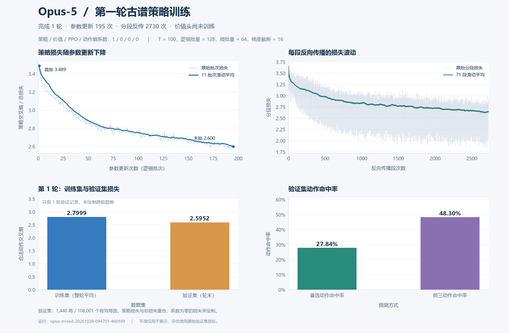

# Opus 第一轮古谱策略训练

2026-10-28 从用户提供的 `return-Opus-20261028-214020-240829` 导入。本次完整完成 1 轮，参数库保留初始化版本和新训练版本，原始导出目录未修改。

| 项目 | 结果 |
|---|---|
| 模型 / 公开名称 | Opus-5 |
| 本地参数编号 | **Opus / ID2，已设为本系列默认** |
| 固定检查点 | `bcdb8df21f5048a88c28f34efb949b8f` |
| 版本名称 | `Opus-5-e1-bcdb8df2` |
| 累计实际训练轮数 | **1** |
| 训练来源 | 古谱 `books` |
| 损失系数：策略 / 价值 / PPO / 动作熵 | **1 / 0 / 0 / 0** |
| 参数更新次数 | 195 |
| 微批量次数 / 分段反传次数 | 390 / 2730 |
| T / 逻辑批量 / 微批量 / 梯度截断 | 100 / 128 / 64 / 16 |
| 学习率 / 权重衰减 | 0.0003 / 0.0001 |
| 训练有效局面数 | 1,895,986 |
| 整轮训练交叉熵 | **2.7999019064** |
| 验证交叉熵 | **2.5952290966** |
| 验证首选动作命中率 | **27.8433%** |
| 验证前三动作命中率 | **48.2977%** |
| 验证规模 | 1,440 局，108,001 个有效局面 |

这是策略训练参数，价值头未接受价值损失监督。参数指标中已明确记录 `value_trained=false`，客户端不会用该价值头输出随机局势概率。

本轮只有一个轮末验证点，`best` 和 `latest` 均指向 ID2。训练图中策略损失与总损失相同，未绘制系数为零的其他损失；滑动平均仅用于显示，未替换原始数据或验证指标。



## 本地文件

- 参数库：`ModelParameters/Opus/models.sqlite3`。
- 完整原始训练日志：`runs/mixed/opus-mixed-20261028-094701-460939/`，包括 TensorBoard、config、metrics、report、best 和 last_completed。
- [结构化训练与导入信息](training_summary.json)，含备份位置、权重和优化器状态校验信息。
- [源导出包校验清单](source_manifest.json)。该清单描述原始导出包，合并后的本地数据库还包括新的默认参数和公开名称配置。
- [PNG 图像](training-curves.png)及[可缩放 SVG 图像](training-curves.svg)。
- [绘图脚本](plot_training.py)，依赖本地保留的原始日志，可重新生成图像。

导入前的 Opus SQLite 已用 SQLite backup API 备份，具体路径写入 `training_summary.json`。ID1 初始化权重保留；新版本权重和完整训练状态与源库逐字节一致。源文件 7 项 SHA-256 校验、数据库完整性、严格加载、CPU 前向和优化器恢复检查均通过。

## 使用

在项目根目录启动并选择本次训练的模型：

```powershell
uv run --locked --extra cpu xiangqi gui --model "Opus-5"
```

查看 Opus 的参数信息：

```powershell
uv run --locked --extra cpu python model_store.py --family Opus list-parameters
uv run --locked --extra cpu python model_store.py --family Opus get-default
```

下一次新训练默认从累计实际轮数最多的 ID2 开始，也可显式使用 `--family Opus --id ID2`。`python -m training` 的 `--epochs` 表示本次追加轮数，实际累计轮数在本次的 1 轮基础上增加。开启价值损失后才开始学习价值头。

参数 SQLite、原始训练日志和备份不随 Git 上传；迁移机器时须单独传输所需数据库和日志。
