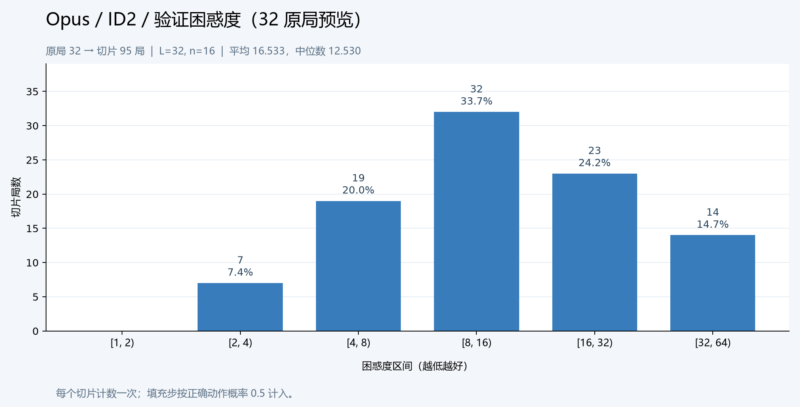

# Opus / ID2 验证切片困惑度预览

2026-10-29 对已保存的 Opus/ID2 重新前向评分，不训练、不新增参数或修改默认指针。使用当前 `Data/dataset.sqlite3` 的 validation 划分，**限定按原局 ID 排序的前 32 局**，L=32、n=16，共 95 局切片、95 个困惑度。这是流程与图表预览，不能当作完整验证集分数，也不能与旧图中的 1,440 局验证指标直接比较。

- 平均切片困惑度：16.532998；中位数：12.529810。
- 2,564 个有效步，476 个填充步；真实步使用棋谱动作概率，填充步固定概率 0.5。
- 完整主库 validation 当前有 1,576 原局、4,682 切片；残局库 112 原局、149 切片；两库合读 1,687 原局、4,830 切片。
- 本目录保留逐片 JSONL、PNG/SVG 和含权重指纹、数据指纹、原局来源及区间计数的 report.json。原训练损失图与历史指标保留原样。

生成预览的评估命令（最后一个路径须为新目录）：

```bash
python -m training.evaluate --family Opus --id 2 --book-source main --L 32 --n 16 --limit-games 32 --micro-batch 16 --cpu-threads 4 --device cpu --no-progress --output artifacts/opus-id2-validation-preview-20261029
```

完整验证请省略 `--limit-games 32`；AutoDL 使用 `--device cuda`。评估方法与训练命令见 [指令.md](../../../../指令.md#验证切片序列困惑度与区间图)。


