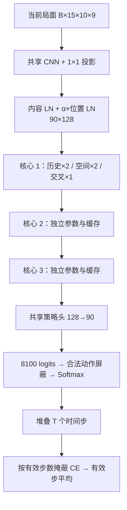

# Haiku-5：训练与部署

本代是棋谱监督学习的策略网络：预测 8100 个起终点动作的合法概率。没有价值头，也不使用旧 ResNet/MCTS。强化学习留作后续阶段。

## 目录与实现

| 路径 | 用途 |
|---|---|
| models/haiku5/ | 第一代网络的配置、实现和掩蔽交叉熵 |
| models/registry.py | 按架构名称构造模型，后续代际在此登记 |
| Data/dataset.sqlite3 | 来源、原始文件/棋谱、校验后的完整动作序列与固定划分 |
| ModelParameters/models.sqlite3 | 配置、权重 BLOB、优化器、指标、latest/best 别名 |
| data_pipeline/ | 导入、记谱解析、规则校验与批量读取 |
| train.py | 训练、验证、保存、最终测试 |
| runs/运行名/ | TensorBoard 事件、history.csv、history.png、evaluation.json、config.json |

默认架构参数：128 维、4 头、FFN 512、3 份核心；每份历史/空间各两层，另有一个交叉层。共 3,043,614 个参数。共享 CNN 使用两层保留棋盘分辨率的 3×3 卷积，GELU 后通过 1×1 投影至 128 维。最后每个起点 Linear(128,90)，展平至 8100。



残差严格使用 LN(x + GELU(AttentionOutput))，随后 LN(h + FFN(h))。行列位置嵌入与内容先分别做无仿射 LayerNorm，再用可学习 α 融合；每个核心独立 β，在该核心历史与交叉查询入口共用。时间编码为正弦/余弦，范围 [-1,1]。空间交叉查询由 LN_qmix(LN_qcontent(S)+βe_t) 独立投影；历史末层 E 已经过 FFN 和 LN，直接投影成交叉 K/V。

每份核心两个 KV_self 和一个 KV_cross，全网共九对缓存。逐时间步仅追加已发生局面，当前 90 个 query 可看窗口内当前及过去所有位置，因此 SDPA 不使用逐 token 下三角遮蔽。填充的历史 key 被单独屏蔽，填充 query 输出置零。缓存是局部对象，换 batch 重新创建；保留梯度，不 detach。注意力重计算在反向重建逐步拼接的 K/V，减少保存中间张量。`--context-plies` 独立设置最大缓存窗口（局面数，包含当前局面），新训练默认 120，与 `--T` 无关；走棋超出窗口会逐整局面淘汰最老的 90 个 token，时间索引继续递增。窗口可大于或小于 T。训练数据超过 T 时只保留最初 T 步，因此很长历史的泛化仍需另外评估。

## 选定的软件与 GPU

固定 **Python 3.12 + PyTorch 2.9.1**。本机已安装 `torch 2.9.1+cpu` 进行验证；远程使用 **2.9.1+cu128（CUDA 12.8）**。这是可复现的选定版本，不宣称是最新版本；不需要 torchvision 或 torchaudio。[PyTorch 官方版本安装表](https://pytorch.org/get-started/previous-versions/)

以下为本方案可选的常用 NVIDIA GPU。显存容量是选购参考，不能视为对本网络 batch=128 一次装入显存的保证。实际峰值受 T、微批量、精度、SDPA 后端影响，需要在服务器上试跑。

| GPU 示例 | Compute Capability | 使用建议 |
|---|---|---|
| A100 40/80GB、A30 | 8.0 | 远程训练，bf16；A100 80GB 更宽裕 |
| RTX 3090/3090 Ti 24GB、RTX A6000 48GB、A40 48GB | 8.6 | 可使用 cu128，微批量从 1 开始 |
| RTX 4090 24GB、L40/L40S 48GB、L4 24GB | 8.9 | 可使用 cu128，优先 bf16 |
| H100/H200 | 9.0 | 可使用 cu128，适合远程训练 |
| RTX 5090 32GB、B200 | 12.0 / 10.0 | 需支持 Blackwell 的构建与对应新驱动，使用 cu128，先运行环境自检 |
| T4、RTX 2080 Ti | 7.5 | 可运行，显存/速度更受限制，使用 fp16 或 fp32 |

GPU 能力号依据 [NVIDIA 官方表](https://developer.nvidia.com/cuda/gpus)。CUDA 与 GPU 架构对应见 [NVIDIA 支持矩阵](https://docs.nvidia.com/datacenter/tesla/drivers/latest/cuda-toolkit-driver-and-architecture-matrix.html)。不把旧卡型号笼统归入本推荐环境。

建议 Linux 驱动 **570.26 或更高**；Windows **570.65 或更高**，新 GPU 还要满足其自身驱动要求。这里采用 CUDA 12.8 GA 配套驱动基线，避免依赖较旧驱动的兼容模式；不是声称所有 CUDA 12.x 程序都要求这个最低版本。[CUDA 12.8 官方驱动表](https://docs.nvidia.com/cuda/archive/12.8.0/cuda-toolkit-release-notes/index.html)

官方 cu128 wheel 会安装所需 CUDA 用户态运行库，运行本项目不必另装系统 CUDA Toolkit；NVIDIA 驱动仍需在主机安装。`nvidia-smi` 的 CUDA 数字是驱动能支持的最高版本，不代表当前 PyTorch wheel 的版本；查看 `torch.version.cuda`。

现在 CPU 与 GPU 环境均由 uv 管理，共用同一份锁文件；按照 [uv 官方 PyTorch 配置方式](https://docs.astral.sh/uv/guides/integration/pytorch/)，用互斥 extras 从官方 CPU/cu128 索引选择同一版本。原 `neural` 是 `cpu` 的兼容别名。

在项目根目录二选一执行，自动创建 `.venv` 并安装 Python 3.12、项目、PyTorch 和训练依赖：

```bash
# 本地 CPU
uv sync --locked --python 3.12 --extra cpu

# AutoDL / NVIDIA GPU
uv sync --locked --python 3.12 --extra gpu
```

AutoDL 如果没有 uv，可在远程终端先执行 `python -m pip install --upgrade uv`，再执行 GPU 命令。须上传本次更新的 pyproject.toml、uv.lock、.python-version；不上传本地 .venv。`cpu` 与 `gpu` 不能同时选，`--all-extras` 会明确报冲突。

终端执行 GPU 程序时始终加 `--extra gpu`；`uv run` 不会永久记住上一次 sync 选择的 extra。PyCharm 则直接使用刚生成的 `.venv/bin/python`，运行时不经过 uv 同步。原 `--extra neural` 选择 CPU 环境，服务器请使用 `gpu`。

安装后执行 GPU 自检：

```bash
uv run --locked --extra gpu python tools/check_training_env.py
```

输出应包含 `2.9.1+cu128`、`CUDA available: True` 和 `CUDA matmul + SDPA forward/backward: OK`。自检也打印解释器完整路径，供 PyCharm 配置使用；会实际执行 CUDA 矩阵乘法和注意力前反向，而不仅检查 `is_available()`。

## PyCharm 远程训练

使用支持 SSH 解释器的 PyCharm Pro：Add Interpreter → On SSH，填写服务器连接后选择 `/你的项目路径/.venv/bin/python`，将本地 `D:\象棋` 映射至远端项目目录。AutoDL 例如 `/root/autodl-tmp/xiangqi/.venv/bin/python`；本地解释器为 `D:\象棋\.venv\Scripts\python.exe`。具体界面见 [JetBrains 官方说明](https://www.jetbrains.com/help/pycharm/configuring-remote-interpreters-via-ssh.html)。

上传源码、pyproject.toml、uv.lock、.python-version、Data/dataset.sqlite3。不要同步本地 .venv、.uv-cache、.git、backups、artifacts；初次训练无需上传源 ZIP/CBL，因为它们已完整包含在 SQLite。训练库读取服务器本机磁盘副本。ModelParameters 和 runs 由服务器生成后，不要用本地内容自动上传覆盖。

创建 Python Run Configuration：Script=远端 train.py，Working directory=远端项目根目录，Parameters：

```text
--epochs 10 --T 120 --batch-size 128 --micro-batch 1 --workers 4 --device cuda --precision auto
```

先用相同结构做短流程自检；`--smoke` 不发布模型到游戏：

```bash
uv run --locked --extra gpu xiangqi-train --epochs 1 --T 120 --batch-size 2 --micro-batch 1 --limit-games 2 --workers 0 --device cuda --smoke --model-db artifacts/gpu-smoke.sqlite3 --output artifacts/gpu-smoke-runs
```

正式训练命令：

```bash
uv run --locked --extra gpu xiangqi-train --epochs 10 --T 120 --batch-size 128 --micro-batch 1 --workers 4 --device cuda --precision auto
```

逻辑 batch=128 指每累积 128 局再更新一次；micro-batch=1 指一次计算一局完整序列。梯度按本次实际有效步总数归一化，最后不足 128 局也会更新。没有截断历史反向传播，调整微批量只改变内存需求和浮点运算顺序。可用显存充足时逐步加到 2、4、8，要求整除逻辑批量。没有 GPU 实测前不承诺吞吐或显存需求。

默认 T=120 是单步总数，即红黑合计 120 步，不是 120 回合；较短棋谱全部时间步补零。公共 `iter_game_batches(T)` 返回 X、one-hot Y、lengths；训练入口使用等价的整数动作标签减少 CPU/GPU 标签存储。模型仍输出 [T,B,8100]，CE 仍按有效时间步平均。标签非法会明确报错，填充不会造成 softmax 全负无穷或 0×负无穷。

例如 `--T 1000 --context-plies 120` 表示训练序列最多 1000 步、K/V 滑动窗口仅 120 个局面。窗口写入训练日志配置与检查点模型配置，推理加载后继续使用该窗口。限制缓存长度不会切断旧计算图；当前未实现分段反传/TBPTT，长序列训练仍需控制微批量和显存。

每轮选择验证 CE 最低的 `best`；训练结束加载 best，仅此时计算测试集 CE、Top-1 和 Top-3 命中率。命中率衡量是否复现棋谱走法，不等于胜率或棋力等级。数据划分详见 Data/README.md。

## 实时查看损失

控制台 tqdm 显示 epoch、微批量进度、累计/当前 loss 和 optimizer step。每个逻辑更新将 loss、梯度范数、α/β 写入 TensorBoard 并 flush；每轮另记录验证损失、Top-1/Top-3，并更新 CSV 和静态 PNG。

远程另开终端：

```bash
uv run --locked --extra gpu tensorboard --logdir runs --host 127.0.0.1 --port 6006
```

本机建立 SSH 转发（替换用户名和服务器地址）：

```text
ssh -L 6006:127.0.0.1:6006 用户名@服务器地址
```

本机浏览器打开 http://127.0.0.1:6006 。训练结束查看 runs/运行名/evaluation.json；每轮的 history.csv/history.png 也可直接下载。

恢复最近一个已完成 epoch（检查点 ID 可在 SQLite checkpoints 表中找到）：

```bash
uv run --locked --extra gpu xiangqi-train --resume 检查点ID --epochs 20 --T 120 --device cuda --precision auto
```

`--epochs` 是总轮数。恢复模型、优化器、GradScaler、随机数状态；须使用相同数据、T 和 seed。当前按 epoch 保存，意外中断后从最后已完成 epoch 重跑，不保证恢复中断 epoch 内的确切 batch。`--evaluate 检查点ID` 可单独评估测试集。

续训及评估未指定 `--context-plies` 时沿用检查点原窗口（旧检查点兼容），显式指定时仅覆盖本次模型的缓存窗口，不改写原检查点；续训保存的新检查点会记住新窗口。窗口变更会重置 best 损失比较，避免最终测试误用旧窗口的 best。专用入口也支持 `python resume_train.py --epochs 3 --context-plies 64`，或在其记录 JSON 中设置 `context_plies`；命令行优先。

## 游戏中的提示

人机对弈在选择玩家执红/执黑后，先进入「选择对弈模型」页面，列表仅显示公开名称；选择后点击「开始对弈」。模型加载成功才创建对局，本局固定使用这份参数。点击新局或返回菜单可重新选择。参数加载失败停留在选择页，走棋计算异常则等待重试原模型；不会自动切换到另一个模型或内置搜索。AI 观战同样在开局前选择。内置搜索可在开局前明确选择。

点击侧栏「AI 提示」或按 H，弹出只包含公开模型名称的列表（例如 `HaiKu-5`、`HaiKu-5.1`）；选定名称后，后台解析对应参数，开始计算。训练轮数、指标、run_id、参数 ID 不进入玩家界面。显示全体合法动作概率最高的三项，概率未在 Top-3 内重新归一化。若合法动作不足三个，则显示实际数量。点击某项仅标出起点与落点，再点棋盘落点才走子。

双人模式支持当前走方；人机模式支持玩家自己的回合。新局、悔棋、落子、切换界面会取消旧请求并丢弃迟到结果。推理使用完整走子历史顺序更新 KV，窗口大小来自该检查点配置。没有已发布名称时列表显示“暂无可用模型”，不会用搜索结果或随机权重充当神经网络提示；发生错误只显示通用提示，详细信息留在后台控制台。

训练保存完成后，将服务器参数库复制到 ModelParameters/models.sqlite3（已有本地版本先备份）；或者保留独立文件，通过 `--model-db 路径` 指定。后台先列出参数信息，再给公开名称绑定一个参数 ID：

```powershell
uv run --locked --extra cpu python model_store.py list-checkpoints
uv run --locked --extra cpu xiangqi gui --model "HaiKu-5" --checkpoint 实际参数ID
```

上述启动方式会持久保存绑定。以后可直接 `uv run --locked --extra cpu xiangqi gui --model "HaiKu-5"`，客户端预选该名称，仍需开局前确认；改 ID 可更新同名模型，也可给不同轮次另取名 `HaiKu-5.1`。未指定名称时在开局前选择，`--mode pve_red/pve_black` 也经过此步骤。提示每次单独选择，不改变本局对手。后台绑定更新只影响之后新开的对局；当前已加载参数保持不变。新训练轮次不会自动更换绑定。发布、下架和按 run_id/best 选参数见 [参数库后台管理](../ModelParameters/README.md)。远程管理使用 `--extra gpu`。

新增代际时，在 models/新目录 实现网络，在 models/registry.py 增加构造分支并在参数库 architectures 表登记；保持配置内 architecture/version/encoding 标识与严格权重加载。不要用旧架构权重填进 Haiku-5。
