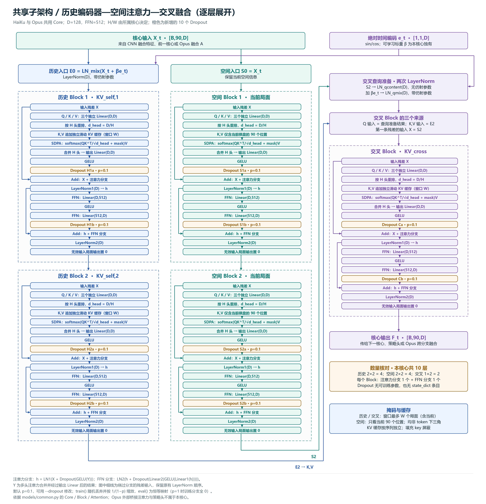

# HaiKu / Opus 网络图（残差 Dropout）

更新日期：2026-10-29。图示依据 `models/HaiKu/network.py`、`models/Opus/network.py` 和 `models/common.py` 的实际计算流程。

| 图片 | PNG | 可放大的 SVG |
|---|---|---|
| HaiKu：CNN、位置编码、三个独立核心与策略头 | [查看](haiku-5-dropout.png) | [查看](haiku-5-dropout.svg) |
| Opus：五个独立核心、双分支融合、策略与价值头 | [查看](opus-5-dropout.png) | [查看](opus-5-dropout.svg) |
| 共享子架构：全部五个 Block 逐层展开，含残差线和 10 个 Dropout | [查看](shared-core-dropout-detailed.png) | [查看](shared-core-dropout-detailed.svg) |

默认特征维度 D=128、FFN 隐藏维度 512，Dropout 概率 0.1。每核心包括历史 Block 两个、空间 Block 两个、交叉 Block 一个；每个 Block 的注意力和 FFN 残差分支各一个 Dropout，总计 10 个。HaiKu 共 30 个，Opus 共 50 个。Opus 的两个外部跨分支单头融合及策略头保持原来的计算结构。

HaiKu 图中的三份核心均采用最新默认 KV 窗口 **30**；Opus 五份核心仍为 10/20/30/20/30。窗口均包含当前局面，每个新微批量重建空缓存，微批量内部的分段反传保留 K/V、只截断梯度。

注意力分支为 `h = LN1(X + Dropout(GELU(Y)))`，Y 是多头注意力经过输出 Linear 的结果。FFN 分支为 `LN2(h + Dropout(Linear2(GELU(Linear1(h)))))`。子架构图显示 Q/K/V 投影、头维度重排、KV 滑动窗口、SDPA、输出投影、激活、残差、LayerNorm、FFN 及填充掩码；细线表示残差旁路，橙色表示新增 Dropout。

监督训练启用 Dropout，验证、对弈和含有效 PPO 损失的整个逻辑批量关闭。Dropout 无可训练参数，不增加 state_dict 字段；旧配置缺失该项时补为 0.1，旧权重与优化器参数顺序兼容。

在项目根目录重新生成全部 PNG/SVG：

```powershell
.venv\Scripts\python.exe tools\draw_dropout_networks.py
```

也可在安装项目依赖后使用 `uv run --locked --extra cpu python tools/draw_dropout_networks.py`。


